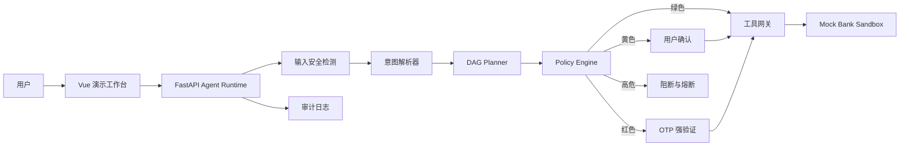
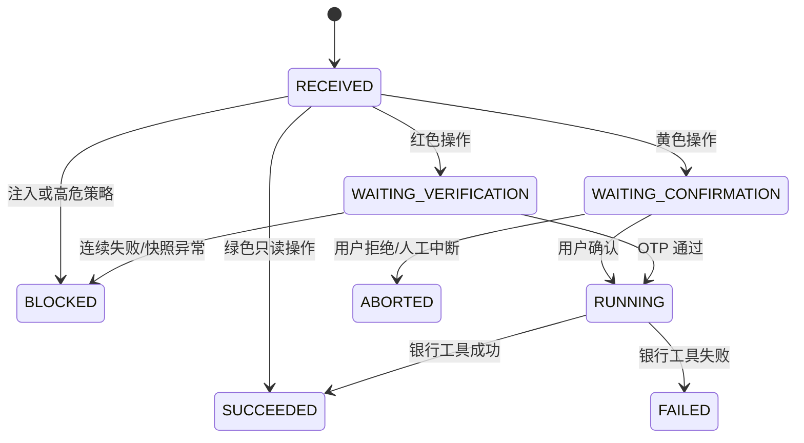

# 系统架构设计

## 1. 总体架构

## 2. 责任边界

| 层级 | 可以做 | 不可以做 |
| --- | --- | --- |
| 前端 | 收集输入、展示计划、提交确认或验证码 | 自行决定风险、修改执行参数 |
| AI 层 | 安全检测、意图理解、生成任务 DAG | 修改账户状态、跳过后端策略 |
| Agent Runtime | 管理 Run 状态、挂起与恢复、连接业务服务 | 信任前端传回的金额或收款人 |
| Policy Engine | 计算最终权限与风险原因 | 接受模型降低风险等级 |
| Mock Bank | 保存演示业务状态、返回事实结果 | 根据自然语言自行推断操作 |
| Audit | 记录安全、策略、确认、验证和执行事件 | 接收前端伪造的执行结果 |

## 3. Agent Run 状态机

## 4. 关键数据对象

- `AgentRun`：一次请求的完整生命周期。
- `Intent`：意图名称、置信度、槽位、缺失字段和风险线索。
- `TaskPlan`：包含依赖关系的 DAG 节点集合。
- `PolicyDecision`：等级、动作、分数、原因和风险因子。
- `Confirmation`：黄色操作的单次授权，绑定操作快照哈希。
- `Verification`：红色操作的强验证会话，最多失败三次。
- `AuditLog`：不可由前端填写的执行证据。

## 5. 当前目录与演进方向

比赛版使用单进程内存仓库，减少部署故障。进入真实环境时替换为 PostgreSQL，并将确认、验证和幂等记录放入具备事务保障的持久化存储；AI、Runtime 和银行业务仍保持现有边界。
